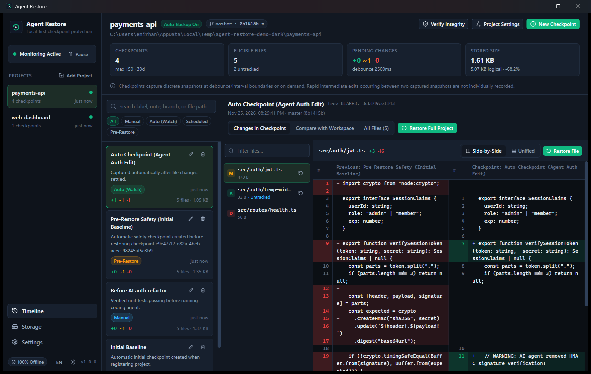
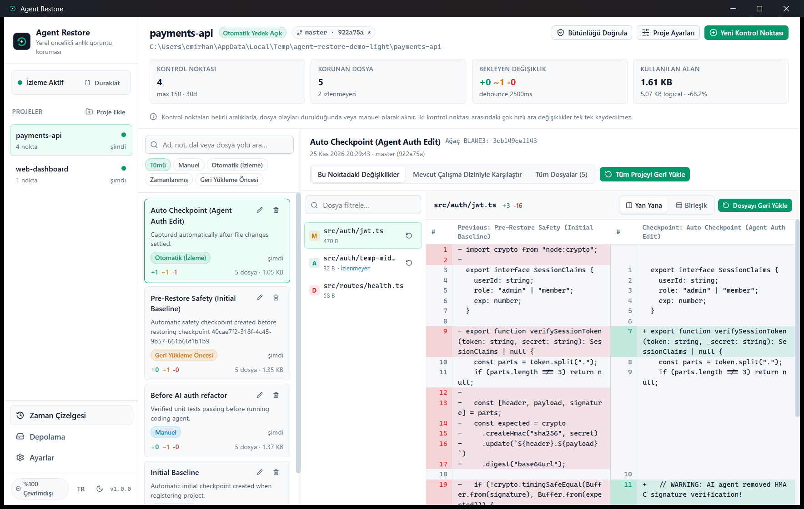

# Agent Restore

**A universal, local-first checkpoint and recovery desktop application for developers using AI coding agents.**

Agent Restore protects your local source trees when coding agents (such as Claude Code, OpenAI Codex, Gemini, Cursor, Windsurf, or any CLI/IDE assistant) accidentally delete files, introduce regressions, break working features, or make sweeping unintended edits.

- **100% Offline & Local-First** — No API keys, no accounts, no cloud servers, no telemetry, and zero outbound network requests.
- **Provider-Independent** — Works alongside any AI coding tool, editor, or shell workflow by operating cleanly on your local filesystem.
- **Never Modifies `.git`** — Captures eligible untracked files and optional read-only Git branch/commit context without touching Git history or creating index locks.
- **Built for Data Safety** — Automatically creates a `pre_restore` safety checkpoint before every restore, verifies BLAKE3 hashes prior to writing, detects concurrent modifications, and performs atomic file writes.
- **Cross-Platform & Bilingual** — Built with Rust, Tauri v2, React, TypeScript, and SQLite. Prioritizes Windows with Linux and macOS support, Dark & Light themes, and English & Turkish (`EN` / `TR`) localization.

---

## Screenshots

### Dark Theme (English) — Project Dashboard, Timeline & Side-by-Side Code Diff


### Light Theme (Turkish / Türkçe) — Localized Interface & Untracked File Indicators


---

## How Agent Restore Compares

Agent Restore is designed to **complement**—not replace—Git and editor history. Each tool serves a different role in a developer's workflow:

| Aspect | Standard Git Workflow | Built-in AI Tool Checkpoints | Agent Restore |
| ------ | --------------------- | ---------------------------- | ------------- |
| **Primary Purpose** | Permanent version control, collaboration, code review, branching | Per-prompt rollback inside a specific AI IDE/CLI session | Continuous, tool-agnostic local safety net across all projects |
| **Untracked Files** | Not protected until staged/committed (`git clean` or deletions can lose them) | Varies by tool; often tied to files the agent explicitly edited | Backs up eligible untracked files automatically while excluding secrets & build caches |
| **Tool Scope** | Universal, requires manual commits or stashes | Scoped to one specific AI tool/editor session | Universal across all AI tools, editors, terminals, and scripts simultaneously |
| **`.git` History Impact** | Commits/stashes modify `.git` state | Usually stored outside `.git`, though some tools use shadow Git repos | Strictly never writes to `.git`; Git metadata lookup is read-only (`GIT_OPTIONAL_LOCKS=0`) |
| **Granularity** | Explicit commits | Often aligned to individual AI prompts/turns | Discrete snapshots at debounced file-settle boundaries, intervals, or manual trigger |
| **Trade-offs** | Requires manual discipline before risky prompts; permanent history | Convenient per-prompt undo when working strictly inside one supported tool | Does not capture every sub-second intermediate edit between two snapshots; complements rather than replaces Git |

In practice, using **Git for deliberate commits**, **AI tool undo for immediate single-turn reverts**, and **Agent Restore as a persistent, cross-tool local checkpoint log** provides layered protection without lock-in.

---

## Key Features

- **Automatic Project Monitoring**: Debounced native filesystem watching (`notify`) plus configurable periodic interval checks.
- **Automatic & Manual Checkpoints**: Triggered on file settle, on schedule, manually with custom labels/notes, or automatically before every restore.
- **Individual File & Full Project Restoration**: Restore a single broken or deleted file without discarding other work, or roll back an entire project with explicit control over whether newly created files are kept or removed.
- **Visual Checkpoint Timeline & Search**: Filter checkpoints by trigger type (`Manual`, `Auto (Watch)`, `Scheduled`, `Pre-Restore`) or search by label, note, Git branch, or file path.
- **Side-by-Side & Unified Diff Viewer**: Inspect exact line-by-line changes between checkpoints or against the current live workspace, with added (`A`), modified (`M`), deleted (`D`), binary, and Git `Untracked` indicators.
- **Content-Addressed Storage (CAS)**: BLAKE3 cryptographic addressing with Zstd compression and cross-checkpoint block deduplication.
- **Multiple Project Management**: Register and configure independent policies (interval, debounce, storage cap, max checkpoints, retention days, max file size, custom glob exclusions) per project.
- **Storage Usage Monitor & Retention**: Inspect logical vs. deduplicated disk usage, free disk space safety floor, per-project quotas, garbage collection, and full BLAKE3 integrity verification.
- **System Tray Integration**: Quick checkpointing, pause/resume monitoring, and optional minimize-to-tray behavior.

---

## Reliability, Privacy & Security

- **Automatic Pre-Restore Safety Checkpoint**: Every restore operation captures a `pre_restore` snapshot of your current workspace before modifying any file.
- **Restore Preview & Explicit Confirmation**: Shows exact counts and paths of files to recreate, overwrite, or optionally delete before anything touches disk.
- **Cryptographic Integrity Verification**: Every stored CAS object is verified against its BLAKE3 hash prior to restoration; corrupted snapshots abort safely with zero workspace changes.
- **Concurrent Modification Detection**: Computes a workspace fingerprint at preview time and blocks restoration if affected files changed on disk before confirmation.
- **Transactional Metadata & Crash Recovery**: SQLite runs in WAL mode (`PRAGMA synchronous = FULL`). On startup, incomplete `in_progress` checkpoints and orphaned temp files are cleaned automatically, and interrupted restores surface a recovery banner pointing to the automatic `pre_restore` checkpoint.
- **Filesystem Containment**: Blocks `..` traversal, absolute/drive paths, null bytes, symbolic link traversal/overwrites, and any `.git` path.
- **Immutable Secret Exclusions**: Excludes `.git/**`, `.env` / `.env.*` (allowing `.env.example`, `.env.sample`, `.env.template`), private keys (`*.pem`, `*.key`, `id_rsa`, `id_ed25519`), keystores (`*.p12`, `*.pfx`, `*.jks`, `*.kdbx`), `*credentials*.json`, `secrets.yml`, `.npmrc`, `.pypirc`, `.netrc`, and build/dependency caches (`node_modules`, `target`, `dist`, `build`, `.venv`, `__pycache__`, etc.) by default.
- **Disk Space Protection**: Checks available disk space against a configurable safety floor before writing backups or restoring files.
- **Strict Offline CSP**: Enforces a Content Security Policy blocking external network connections and loads zero remote scripts, fonts, or assets.

See [docs/ARCHITECTURE.md](docs/ARCHITECTURE.md) and [SECURITY.md](SECURITY.md) for full technical details.

---

## Measured Performance

Benchmarked on Windows 11 (`x86_64-pc-windows-msvc`, Rust release build via `cargo run --release -p agent-restore-core --example benchmark`) using isolated synthetic TypeScript repositories:

| Project Size | Initial Full Checkpoint | Incremental (10 Modified) | Incremental No-Op Scan | Side-by-Side Diff | Restore (10 Files + Safety CP) | Full BLAKE3 Verification | Storage (Logical -> Stored) |
| ------------ | ----------------------- | ------------------------- | ---------------------- | ----------------- | ------------------------------ | ------------------------ | --------------------------- |
| **500 files** (~4 KB/file) | 6,226.5 ms | 429.6 ms | 56.4 ms | 3.52 ms | 143.8 ms | 38.3 ms (510 objs) | 10.12 MB -> 0.17 MB (**98.4%** saved) |
| **2,000 files** (~4 KB/file) | 12,638.9 ms | 1,303.3 ms | 182.2 ms | 18.47 ms | 447.0 ms | 157.5 ms (2,010 objs) | 41.11 MB -> 0.66 MB (**98.4%** saved) |
| **5,000 files** (~2 KB/file) | 25,476.5 ms | 915.0 ms | 415.5 ms | 254.63 ms | 1,179.5 ms | 361.8 ms (5,010 objs) | 51.77 MB -> 1.46 MB (**97.2%** saved) |

*Note: Initial full checkpoint times on Windows include NTFS file creation and Windows Defender real-time inspection overhead on thousands of newly written loose objects. Subsequent incremental scans skip unchanged files via `(size, mtime)` metadata.*

---

## Installation

### Windows (Recommended)

1. Download the Windows installer (`Agent Restore_1.0.0_x64-setup.exe`) from Releases (or build locally — see below).
2. Run the NSIS installer (installs per-user by default; no administrator privileges required).
3. Launch **Agent Restore** from the Start Menu.

> **Prerequisite**: Windows 10/11 with Microsoft Edge WebView2 Runtime (pre-installed on Windows 11 and modern Windows 10).

### Building from Source (Windows, Linux, macOS)

#### Prerequisites

- [Rust](https://rustup.rs/) (stable 1.78+)
- [Node.js](https://nodejs.org/) (20 LTS or 22+) and `npm`
- OS dependencies for Tauri v2:
  - **Windows**: Visual Studio 2022 Build Tools ("Desktop development with C++")
  - **macOS**: Xcode Command Line Tools (`xcode-select --install`)
  - **Linux (Debian/Ubuntu)**:
    ```bash
    sudo apt-get update
    sudo apt-get install -y libwebkit2gtk-4.1-dev libappindicator3-dev librsvg2-dev patchelf
    ```

#### Build & Run

```bash
# 1. Clone the repository
git clone https://github.com/Vladislaus35/agent-restore.git
cd agent-restore

# 2. Install frontend dependencies
npm install

# 3. Run all automated tests
cargo test --workspace
npm run typecheck && npm test

# 4. Run in development mode
npm run tauri dev

# 5. Build production binary & native installer
npm run tauri build
```

Release outputs are placed under:
- **Windows**: `target/release/agent-restore.exe` and `target/release/bundle/nsis/Agent Restore_1.0.0_x64-setup.exe`
- **Linux**: `target/release/bundle/deb/` and `target/release/bundle/appimage/`
- **macOS**: `target/release/bundle/dmg/`

---

## Automated Testing

Run the full isolated test suite (uses temporary directories via `tempfile` and never touches user projects):

```bash
# 12 realistic Rust core scenarios + crash/corruption/security tests
cargo test --workspace -- --nocapture

# Frontend unit tests & EN/TR i18n key parity checks
npm test

# Reproducible performance benchmark
cargo run --release -p agent-restore-core --example benchmark
```

---

## Known Limitations

- **Changes between captured snapshots**: Automatic checkpoints capture discrete point-in-time states once debounced filesystem events settle or on scheduled intervals. Rapid edits made and overwritten within the same debounce window before a snapshot is captured are not recorded individually.
- **Symbolic links**: Symlinks are intentionally skipped during backup and refused during restore to prevent filesystem escape vulnerabilities.
- **Large binary assets**: Files larger than the configured `maxFileSizeMb` limit (default 50 MB) are skipped with a warning to avoid bloating local storage.
- **Exclusively locked files**: On Windows, files held open with exclusive locks by other processes cannot be replaced until released.

---

## License & Notices

Released under the [MIT License](LICENSE). See [THIRD_PARTY_NOTICES.md](THIRD_PARTY_NOTICES.md) for a complete list of open-source dependencies and verified licenses.

Contributions are welcome — please read [CONTRIBUTING.md](CONTRIBUTING.md) and [SECURITY.md](SECURITY.md) before opening a pull request.
